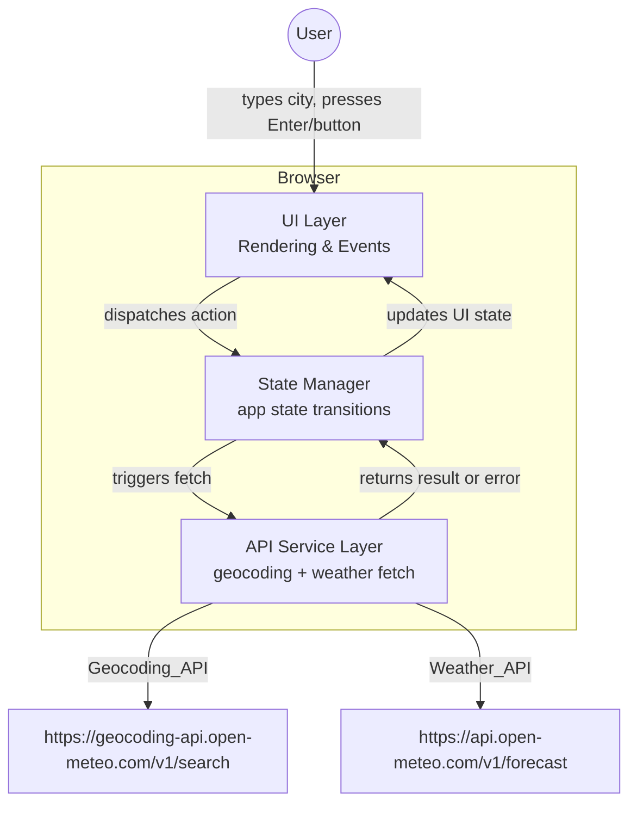

# Design Document

## Overview

La aplicación **Weather Forecast App** es una SPA (Single Page Application) web de página única que permite al usuario consultar el pronóstico meteorológico actual de cualquier ciudad del mundo. El flujo principal consiste en tres pasos: validación de la entrada, geocodificación del nombre de ciudad a coordenadas, y consulta del pronóstico con esas coordenadas.

La app se construye como una aplicación frontend pura (HTML + CSS + JavaScript vanilla o framework ligero), sin backend propio. Todo el procesamiento ocurre en el navegador, consumiendo directamente las APIs públicas y gratuitas de [Open-Meteo](https://open-meteo.com/en/docs/) sin necesidad de clave de API.

**Decisiones de diseño clave:**

- **Sin backend propio**: Las APIs de Open-Meteo son públicas, sin autenticación, por lo que no se necesita un servidor intermediario. Esto simplifica el despliegue y elimina costos de infraestructura.
- **`fetch` nativo con `AbortController`**: Se usa la API estándar del navegador para las peticiones HTTP, con soporte de timeout mediante `AbortController` para cumplir el límite de 10 segundos definido en los requisitos.
- **Estado centralizado en un único módulo**: Toda la lógica de estado de la UI se mantiene en un objeto de estado explícito, lo que facilita el razonamiento sobre transiciones y evita inconsistencias entre el `Forecast_Display` y el `Error_Display`.

---

## Architecture

La aplicación sigue una arquitectura cliente-only de tres capas:



**Flujo de datos:**

1. El usuario ingresa un nombre de ciudad y envía el formulario.
2. La capa de UI valida la entrada (trim + vacío) y llama al State Manager.
3. El State Manager pone la app en estado `loading`, limpia resultados previos y llama al API Service.
4. El API Service realiza la petición a la Geocoding API; si hay resultado, extrae las coordenadas y llama a la Weather API.
5. El API Service retorna un objeto `WeatherResult` o un `AppError` al State Manager.
6. El State Manager transiciona al estado `success` o `error` y notifica a la UI para que se re-renderice.

---

## Components and Interfaces

### Componentes de UI

| Componente | Descripción |
|---|---|
| `SearchForm` | Campo de texto `City_Input` + botón de búsqueda. Maneja el evento `submit` y la tecla Enter. |
| `LoadingIndicator` | Spinner o indicador visual ≥ 24×24 px. Visible solo durante el estado `loading`. |
| `ForecastDisplay` | Tarjeta que muestra ciudad, temperatura, humedad y precipitaciones. Visible solo en estado `success`. |
| `ErrorDisplay` | Mensaje de error textual. Visible solo en estado `error`. |

### Interfaces TypeScript / JsDoc

```typescript
// Estado global de la aplicación
type AppState =
  | { status: 'idle' }
  | { status: 'loading' }
  | { status: 'success'; data: WeatherResult }
  | { status: 'error'; message: string };

// Resultado de una consulta exitosa
interface WeatherResult {
  cityName: string;
  temperature: number | null;       // °C, 1 decimal
  humidity: number | null;          // %, entero 0–100
  precipitation: number | null;     // mm, 1 decimal
}

// Respuesta normalizada de la Geocoding API
interface GeocodingResult {
  latitude: number;
  longitude: number;
  name: string;
}

// Error tipado para manejar distintos casos de fallo
type AppError =
  | { kind: 'empty_input' }
  | { kind: 'city_not_found' }
  | { kind: 'geocoding_unavailable' }
  | { kind: 'weather_unavailable' }
  | { kind: 'weather_timeout' }
  | { kind: 'unexpected_geocoding_response' }
  | { kind: 'unexpected_weather_response' };
```

### API Service — Contratos

```typescript
// Geocoding
async function geocodeCity(cityName: string): Promise<GeocodingResult>
// Lanza AppError con kind correspondiente en caso de fallo

// Weather
async function fetchWeather(lat: number, lon: number): Promise<WeatherResult>
// Lanza AppError con kind correspondiente en caso de fallo
```

---

## Data Models

### Geocoding API — Request / Response

**Endpoint:** `GET https://geocoding-api.open-meteo.com/v1/search`

| Parámetro | Valor |
|---|---|
| `name` | Nombre de ciudad (trim aplicado) |
| `count` | `1` (solo el primer resultado) |
| `language` | `en` |
| `format` | `json` |

**Respuesta exitosa (ejemplo):**

```json
{
  "results": [
    {
      "id": 3117735,
      "name": "Madrid",
      "latitude": 40.41650,
      "longitude": -3.70256,
      "country": "Spain",
      "country_code": "ES"
    }
  ],
  "generationtime_ms": 0.49
}
```

**Campos relevantes:** `results[0].latitude`, `results[0].longitude`, `results[0].name`

**Casos de error:**
- `results` ausente o nulo → `unexpected_geocoding_response`
- `results` vacío (`[]`) → `city_not_found`
- Error de red / HTTP 4xx–5xx → `geocoding_unavailable`

---

### Weather API — Request / Response

**Endpoint:** `GET https://api.open-meteo.com/v1/forecast`

| Parámetro | Valor |
|---|---|
| `latitude` | Latitud de la ciudad |
| `longitude` | Longitud de la ciudad |
| `current` | `temperature_2m,relative_humidity_2m,precipitation` |

**Respuesta exitosa (ejemplo):**

```json
{
  "latitude": 40.42,
  "longitude": -3.7,
  "current": {
    "time": "2025-01-15T14:00",
    "interval": 900,
    "temperature_2m": 12.3,
    "relative_humidity_2m": 65,
    "precipitation": 0.0
  },
  "current_units": {
    "temperature_2m": "°C",
    "relative_humidity_2m": "%",
    "precipitation": "mm"
  }
}
```

**Campos relevantes:** `current.temperature_2m`, `current.relative_humidity_2m`, `current.precipitation`

**Casos de error:**
- `current` ausente o nulo → `unexpected_weather_response`
- Error de red → `weather_unavailable`
- HTTP 4xx–5xx → `weather_unavailable`
- Timeout (> 10 s) → `weather_timeout`

---

### Mensajes de error por tipo

| `AppError.kind` | Mensaje mostrado al usuario |
|---|---|
| `empty_input` | "Por favor, ingresa el nombre de una ciudad" |
| `city_not_found` | "No se encontró la ciudad. Verifica el nombre e intenta de nuevo." |
| `geocoding_unavailable` | "El servicio de geocodificación no está disponible. Intenta más tarde." |
| `weather_unavailable` | "No fue posible obtener el pronóstico. Intenta más tarde." |
| `weather_timeout` | "El servicio tardó demasiado en responder. Intenta más tarde." |
| `unexpected_geocoding_response` | "La respuesta del servicio de geocodificación fue inesperada." |
| `unexpected_weather_response` | "La respuesta del servicio de clima fue inesperada." |

---

## Correctness Properties

*Una propiedad es una característica o comportamiento que debe mantenerse verdadero en todas las ejecuciones válidas del sistema — esencialmente, una declaración formal sobre lo que el sistema debe hacer. Las propiedades sirven como puente entre las especificaciones legibles por humanos y las garantías de corrección verificables automáticamente.*

### Property 1: Entrada con solo espacios en blanco siempre produce error de validación

*Para cualquier* cadena compuesta únicamente de caracteres de espacio en blanco (espacios, tabulaciones, etc.), enviar esa cadena como entrada en el formulario debe producir el mensaje de error "Por favor, ingresa el nombre de una ciudad" y no debe realizarse ninguna petición a la Geocoding_API.

**Validates: Requirements 1.3, 1.4, 2.6**

---

### Property 2: Trim del input antes de llamar a la API

*Para cualquier* nombre de ciudad con espacios en blanco al inicio o al final, el valor enviado a la Geocoding_API debe ser igual al nombre con esos espacios eliminados (es decir, igual a `cityName.trim()`).

**Validates: Requirements 1.4, 2.1**

---

### Property 3: Petición a Geocoding_API con parámetros correctos

*Para cualquier* nombre de ciudad válido (no vacío después del trim, longitud ≤ 100), al enviar el formulario, la aplicación debe realizar exactamente una petición a la Geocoding_API que incluya el parámetro `count=1` y el nombre de ciudad como valor del parámetro `name`.

**Validates: Requirements 2.1, 2.5**

---

### Property 4: Coordenadas del primer resultado se reenvían a la Weather_API

*Para cualquier* respuesta de la Geocoding_API que contenga al menos un resultado, la latitud y la longitud enviadas en la petición a la Weather_API deben ser iguales a `results[0].latitude` y `results[0].longitude` respectivamente.

**Validates: Requirements 2.2**

---

### Property 5: Petición a Weather_API incluye las variables requeridas

*Para cualquier* par de coordenadas válidas (latitud, longitud), la petición a la Weather_API debe incluir en el parámetro `current` exactamente los tres campos: `temperature_2m`, `relative_humidity_2m` y `precipitation`.

**Validates: Requirements 3.1**

---

### Property 6: Extracción de datos desde la respuesta de la Weather_API

*Para cualquier* respuesta exitosa de la Weather_API que contenga el objeto `current`, el objeto `WeatherResult` producido debe satisfacer: `temperature = current.temperature_2m`, `humidity = current.relative_humidity_2m`, `precipitation = current.precipitation` (o `null` si el campo está ausente o nulo en la respuesta).

**Validates: Requirements 3.2, 4.5**

---

### Property 7: Renderizado correcto de los datos meteorológicos

*Para cualquier* `WeatherResult` con valores no nulos, el componente `ForecastDisplay` renderizado debe:
- Contener el nombre de la ciudad exactamente como fue consultada.
- Mostrar la temperatura con exactamente un decimal seguido de `°C` (e.g., `12.3°C`).
- Mostrar la humedad como un número entero entre 0 y 100 seguido de `%` (e.g., `65%`).
- Mostrar las precipitaciones con exactamente un decimal seguido de ` mm` (e.g., `0.0 mm`).
- Para cualquier campo que sea `null`, mostrar el indicador textual de dato no disponible (e.g., `N/A`) en lugar del valor.

**Validates: Requirements 4.1, 4.2, 4.3, 4.4, 4.5**

---

### Property 8: Exclusividad mutua entre ForecastDisplay y ErrorDisplay

*Para cualquier* estado de la aplicación, el `ForecastDisplay` y el `ErrorDisplay` no pueden estar visibles simultáneamente: cuando el estado es `success`, el `ErrorDisplay` debe estar oculto; cuando el estado es `error`, el `ForecastDisplay` debe estar oculto; cuando el estado es `loading` o `idle`, ambos deben estar ocultos.

**Validates: Requirements 5.3, 5.4**

---

### Property 9: Nueva búsqueda limpia el estado previo antes de mostrar la carga

*Para cualquier* estado previo de la aplicación (`success` o `error`), al iniciar una nueva búsqueda válida, la aplicación debe transicionar a un estado `loading` en el que tanto el `ForecastDisplay` como el `ErrorDisplay` estén ocultos antes de que llegue la respuesta de la API.

**Validates: Requirements 4.7**

---

### Property 10: El City_Input permanece habilitado tras cualquier error

*Para cualquier* tipo de `AppError`, después de que el `ErrorDisplay` muestre el mensaje de error, el elemento `City_Input` debe estar habilitado (no deshabilitado) y debe recibir el foco, permitiendo al usuario corregir su búsqueda sin recargar la página.

**Validates: Requirements 5.5**

---

## Error Handling

La estrategia de manejo de errores se basa en un tipo discriminado `AppError` con un `kind` string que mapea cada condición de fallo a un mensaje específico para el usuario. Esto centraliza el mapeo error → mensaje y facilita las pruebas.

### Árbol de decisión de errores

```mermaid
graph TD
    A[Submit formulario] --> B{Input vacío o solo espacios?}
    B -- Sí --> C[empty_input error]
    B -- No --> D[Llamar Geocoding_API]
    D --> E{¿Error de red o HTTP?}
    E -- Sí --> F[geocoding_unavailable error]
    E -- No --> G{¿Campo results ausente o nulo?}
    G -- Sí --> H[unexpected_geocoding_response error]
    G -- No --> I{¿results vacío?}
    I -- Sí --> J[city_not_found error]
    I -- No --> K[Llamar Weather_API con coords de results[0]]
    K --> L{¿Timeout > 10s?}
    L -- Sí --> M[weather_timeout error]
    L -- No --> N{¿Error de red o HTTP?}
    N -- Sí --> O[weather_unavailable error]
    N -- No --> P{¿Campo current ausente o nulo?}
    P -- Sí --> Q[unexpected_weather_response error]
    P -- No --> R[Success: mostrar WeatherResult]
```

### Timeout con AbortController

Para cumplir el límite de 10 segundos definido en los requisitos, se utiliza `AbortController` junto con `setTimeout`:

```javascript
const controller = new AbortController();
const timeoutId = setTimeout(() => controller.abort(), 10_000);
try {
  const response = await fetch(url, { signal: controller.signal });
  // ...
} catch (err) {
  if (err.name === 'AbortError') throw { kind: 'weather_timeout' };
  throw { kind: 'weather_unavailable' };
} finally {
  clearTimeout(timeoutId);
}
```

### Invariantes de estado de UI

- `ForecastDisplay` solo se muestra cuando `AppState.status === 'success'`.
- `ErrorDisplay` solo se muestra cuando `AppState.status === 'error'`.
- `LoadingIndicator` solo se muestra cuando `AppState.status === 'loading'`.
- Al iniciar una nueva búsqueda, el estado transiciona a `loading` **sincrónicamente** antes de cualquier llamada asíncrona, garantizando que el estado previo (éxito o error) desaparezca en el mismo ciclo de renderizado.
- El `City_Input` nunca se deshabilita programáticamente; permanece interactivo en todo momento.

---

## Testing Strategy

### Enfoque dual: tests unitarios + property-based testing

La aplicación combina dos tipos de pruebas complementarias:

| Tipo | Herramienta | Propósito |
|---|---|---|
| Tests unitarios (ejemplo-based) | [Vitest](https://vitest.dev/) | Casos concretos, edge cases, interacciones de UI específicas |
| Property-based tests | [fast-check](https://github.com/dubzzz/fast-check) | Propiedades universales sobre rangos de inputs |

### Tests de propiedades (property-based)

Se implementa un test de propiedad por cada propiedad definida en la sección de Correctness Properties. Cada test se ejecuta con un mínimo de **100 iteraciones** mediante `fast-check`.

**Configuración:**

```javascript
// vitest.config.js
import { defineConfig } from 'vitest/config';
export default defineConfig({
  test: { globals: true }
});
```

**Etiquetado de tests:**

Cada test de propiedad debe incluir un comentario con el tag de referencia:

```javascript
// Feature: weather-forecast-app, Property 1: Whitespace input always produces validation error
test('whitespace input always produces validation error', () => {
  fc.assert(
    fc.property(fc.string({ minLength: 1 }).filter(s => s.trim() === ''), (input) => {
      // ...
    }),
    { numRuns: 100 }
  );
});
```

### Tests unitarios (ejemplo-based)

Los tests unitarios cubren:

- **Flujo feliz**: búsqueda exitosa de una ciudad conocida con respuestas mockeadas de ambas APIs.
- **Interacción de Enter**: verificar que la tecla Enter en el input dispara la búsqueda.
- **Indicador de carga**: verificar que el spinner aparece durante una petición en curso (con `fetch` mockeado que no resuelve de inmediato).
- **Timeout de 10 segundos**: verificar que después de 10 segundos sin respuesta se muestra el mensaje de timeout.
- **Errores de red en Geocoding_API y Weather_API**: cada `AppError.kind` mapeado a su mensaje correcto.
- **Respuestas con estructura inesperada**: campo `results` nulo, campo `current` nulo.

### Cobertura mínima esperada

| Módulo | Cobertura objetivo |
|---|---|
| `api/geocoding.js` | 90% |
| `api/weather.js` | 90% |
| `state/reducer.js` | 95% |
| `ui/formatters.js` | 100% (funciones puras) |
| `ui/components.js` | 80% |
